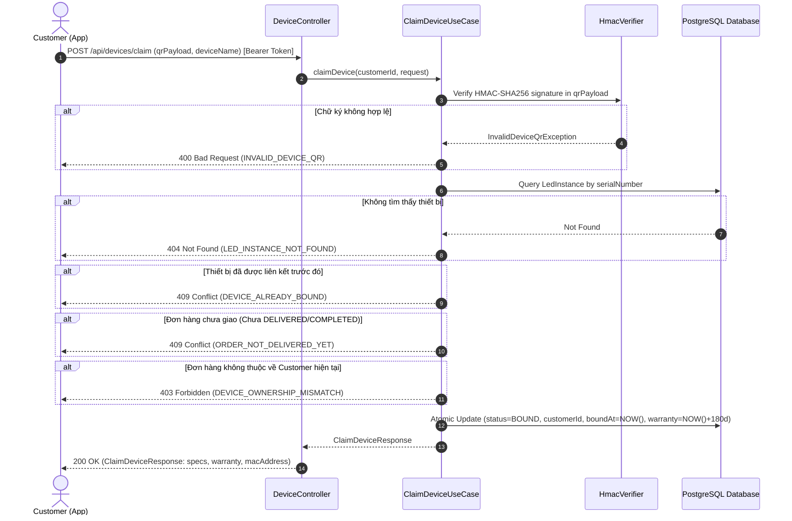

# API Contract: Quản lý Thiết bị Khách hàng (Customer Device Management)

Tài liệu đặc tả hợp đồng API dành cho đội ngũ phát triển Mobile/Web Frontend và Backend phục vụ việc tích hợp các tính năng **Quét QR kích hoạt thiết bị (Claim Device)**, **Xem danh sách thiết bị sở hữu (List Devices)** và **Xem chi tiết cấu hình phần cứng thiết bị (Get Device Detail)**.

Tài liệu được chuẩn hóa trực tiếp dựa trên bộ kiểm thử tự động [DeviceControllerTest.java](file:///d:/Download%20Folder/University/SE_9/SEP_Project/BE/backend/src/test/java/com/lumintra/backend/device/DeviceControllerTest.java) và controller [DeviceController.java](file:///d:/Download%20Folder/University/SE_9/SEP_Project/BE/backend/src/main/java/com/lumintra/backend/device/api/controller/DeviceController.java).

---

## 1. Thông tin chung (General Information)

- **Base URL**: `http://localhost:8080` (hoặc domain môi trường server)
- **Chuẩn dữ liệu**: `application/json; charset=UTF-8`
- **Xác thực (Authentication)**:
  - Giao thức: `Bearer Token (JWT)`
  - Header bắt buộc: `Authorization: Bearer <access_token>`
  - Yêu cầu phân quyền (RBAC): Chỉ người dùng có Role **`CUSTOMER`** mới có quyền truy cập. Token `sub` (principal) phải là `customerId` dạng số nguyên dương.
- **Quy ước phản hồi chuẩn (ApiResponse Envelope)**:
  - Phản hồi đơn lẻ (Single Object):
    ```json
    {
      "code": "SUCCESS",
      "message": "Thành công",
      "data": { ... },
      "meta": null
    }
    ```
  - Phản hồi phân trang (Paginated List):
    ```json
    {
      "code": "SUCCESS",
      "message": "Thành công",
      "data": [ { ... }, { ... } ],
      "meta": {
        "page": 0,
        "size": 20,
        "totalElements": 42,
        "totalPages": 3,
        "hasNext": true,
        "hasPrevious": false
      }
    }
    ```
  - Phản hồi lỗi chuẩn (Standard ErrorResponse):
    ```json
    {
      "code": "ERROR_CODE",
      "message": "Mô tả chi tiết nguyên nhân lỗi",
      "status": 400,
      "timestamp": "2026-11-14T10:15:30Z",
      "traceId": "4bf92f3577b34da6a3ce929d0e0e4736",
      "details": [
        {
          "field": "qrPayload",
          "message": "qrPayload is required"
        }
      ]
    }
    ```

---

## 2. Quy trình Kích hoạt & Ràng buộc Thiết bị (Device Claiming Workflow)

Khi khách hàng nhận được hộp sản phẩm đèn LED Lumintra:
1. Thiết bị xuất xưởng mang một mã QR nhà máy duy nhất dán trên thân máy.
2. Ứng dụng di động của khách hàng quét mã QR, trích xuất chuỗi JSON `qrPayload`.
3. Ứng dụng gửi `POST /api/devices/claim` kèm JWT token của khách hàng.
4. Backend thực hiện 4 bước kiểm tra nghiêm ngặt:
   - **Xác thực chữ ký HMAC-SHA256**: Đảm bảo QR là chính hãng từ nhà máy Lumintra và không bị giả mạo.
   - **Kiểm tra trạng thái thiết bị**: Thiết bị phải chưa từng được liên kết với bất kỳ tài khoản nào (`status != BOUND`).
   - **Xác minh quyền sở hữu đơn hàng (Fulfillment & Ownership)**: Thiết bị vật lý phải được xuất kho (fulfilled) cho một đơn hàng thuộc quyền sở hữu của chính khách hàng này (`order.customerId == authenticatedCustomerId`).
   - **Kiểm tra trạng thái đơn hàng**: Đơn hàng tương ứng phải ở trạng thái `DELIVERED` (Đã giao hàng) hoặc `COMPLETED` (Hoàn tất).
5. **Kích hoạt thành công**: Thiết bị được chuyển sang trạng thái `BOUND`, kích hoạt gói bảo hành chính hãng **180 ngày** (`warrantyExpiresAt = boundAt + 180 days`), và trả về thông số phần cứng để ứng dụng kết nối BLE.



---

## 3. Danh sách Chi tiết các API

---

### 3.1. Quét QR Kích hoạt Thiết bị (Claim Device via QR Code)

- **Mã chức năng**: `DEV-93`
- **Endpoint**: `POST /api/devices/claim`
- **Method**: `POST`
- **Phân quyền**: Role `CUSTOMER`
- **Mục đích**: Xác thực chữ ký số HMAC-SHA256 trên tem QR nhà máy, ràng buộc vĩnh viễn thiết bị LED vào tài khoản khách hàng, kích hoạt bảo hành 180 ngày.

#### A. Request Headers
| Header | Giá trị | Bắt buộc | Mô tả |
| :--- | :--- | :--- | :--- |
| `Authorization` | `Bearer <access_token>` | **Có** | JWT access token của tài khoản Customer |
| `Content-Type` | `application/json` | **Có** | `application/json` |

#### B. Request Body Schema (`ClaimDeviceRequest`)
| Thuộc tính | Kiểu dữ liệu | Bắt buộc | Ràng buộc / Validation | Mô tả |
| :--- | :--- | :--- | :--- | :--- |
| `qrPayload` | `String` | **Có** | `@NotBlank` | Chuỗi JSON quét được từ mã QR nhà máy (chứa version `v`, số serial `sn`, địa chỉ MAC `mac`, chữ ký `sig`). |
| `deviceName` | `String` | Không | `@Size(max = 255)` | Tên tùy chỉnh khách hàng đặt cho thiết bị (nếu để trống, backend tự động lấy tên model LED làm mặc định). |

*Ví dụ chuỗi QR Payload bên trong mã QR nhà máy:*
```json
{
  "v": 1,
  "sn": "LMT-64X64-0005",
  "mac": "AA:BB:CC:11:22:05",
  "sig": "9f2c8b01a4d7e6f5c3b2a1908f7e6d5c4b3a291807f6e5d4c3b2a1908f7e6d5c"
}
```

*Ví dụ Request Body gửi lên API:*
```json
{
  "qrPayload": "{\"v\":1,\"sn\":\"LMT-64X64-0005\",\"mac\":\"AA:BB:CC:11:22:05\",\"sig\":\"9f2c8b01a4d7e6f5c3b2a1908f7e6d5c4b3a291807f6e5d4c3b2a1908f7e6d5c\"}",
  "deviceName": "Đèn Kính Sau Xe Mazda 3"
}
```

#### C. Response Schema 200 OK (`ClaimDeviceResponse`)
| Thuộc tính | Kiểu dữ liệu | Mô tả |
| :--- | :--- | :--- |
| `deviceId` | `Long` | ID định danh duy nhất của thiết bị LED (LedInstance PK) |
| `serialNumber` | `String` | Số Serial sản xuất từ nhà máy (ví dụ: `LMT-64X64-0005`) |
| `macAddress` | `String` | Địa chỉ BLE MAC in hoa phân cách bằng dấu hai chấm (ví dụ: `AA:BB:CC:11:22:05`) phục vụ App kết nối Bluetooth |
| `deviceName` | `String` | Tên hiển thị của thiết bị (tên khách hàng đặt hoặc tên model) |
| `modelId` | `Long` | ID của dòng model phần cứng tương ứng |
| `modelName` | `String` | Tên dòng model phần cứng (ví dụ: `Lumintra Matrix 64x64 Pro`) |
| `spec` | `Object` | Thông số kỹ thuật hiển thị canvas và phần cứng: |
| `spec.widthPx` | `Integer` | Chiều rộng ma trận điểm ảnh LED (ví dụ: `64`) |
| `spec.heightPx`| `Integer` | Chiều cao ma trận điểm ảnh LED (ví dụ: `64`) |
| `spec.attributes` | `List<SpecAttribute>` | Danh sách thuộc tính mở rộng (ví dụ: `[{"label": "Voltage", "value": "5V USB-C"}]`) |
| `boundAt` | `String (ISO-8601)` | Thời điểm kích hoạt ràng buộc thành công (UTC) |
| `warrantyExpiresAt` | `String (ISO-8601)` | Thời điểm hết hạn bảo hành chính hãng 180 ngày (UTC) |

*Ví dụ Response 200 OK:*
```json
{
  "deviceId": 1005,
  "serialNumber": "LMT-64X64-0005",
  "macAddress": "AA:BB:CC:11:22:05",
  "deviceName": "Đèn Kính Sau Xe Mazda 3",
  "modelId": 101,
  "modelName": "Lumintra Matrix 64x64 Pro",
  "spec": {
    "widthPx": 64,
    "heightPx": 64,
    "attributes": [
      {
        "label": "Voltage",
        "value": "5V USB-C"
      }
    ]
  },
  "boundAt": "2026-11-14T08:00:00Z",
  "warrantyExpiresAt": "2027-05-13T08:00:00Z"
}
```

#### D. Mã lỗi có thể xảy ra (Error Scenarios)
| HTTP Code | Error Code | Nguyên nhân & Hướng xử lý |
| :--- | :--- | :--- |
| `400` | `VALIDATION_FAILED` | `qrPayload` rỗng hoặc `deviceName` vượt quá 255 ký tự. |
| `400` | `INVALID_DEVICE_QR` | Chữ ký số HMAC-SHA256 không hợp lệ, dữ liệu QR bị sửa đổi hoặc định dạng JSON sai. |
| `401` | `UNAUTHORIZED` | Thiếu access token hoặc token hết hạn. |
| `401` | `INVALID_CREDENTIALS` | Token principal không phải là Customer ID hợp lệ dạng số nguyên. |
| `403` | `FORBIDDEN` | Tài khoản không có vai trò `CUSTOMER` (ví dụ tài khoản Manager/Staff). |
| `403` | `DEVICE_OWNERSHIP_MISMATCH` | Thiết bị này thuộc đơn hàng của một khách hàng khác (không khớp Customer ID). |
| `404` | `LED_INSTANCE_NOT_FOUND` | Không tìm thấy thiết bị mang số Serial trong hệ thống Lumintra. |
| `409` | `DEVICE_ALREADY_BOUND` | Thiết bị này đã được kích hoạt và gán vào một tài khoản trước đó. |
| `409` | `ORDER_NOT_DELIVERED_YET` | Đơn hàng mua thiết bị này chưa được giao thành công (chưa đạt `DELIVERED` hoặc `COMPLETED`). |
| `500` | `INTERNAL_SERVER_ERROR` | Lỗi cơ sở dữ liệu hoặc sự cố hệ thống ngoài dự kiến. |

---

### 3.2. Lấy Danh sách Thiết bị đã sở hữu (List Customer Owned Devices)

- **Mã chức năng**: `DEV-94`
- **Endpoint**: `GET /api/devices`
- **Method**: `GET`
- **Phân quyền**: Role `CUSTOMER`
- **Mục đích**: Lấy danh sách phân trang các thiết bị LED thuộc quyền sở hữu của khách hàng đang đăng nhập, sắp xếp theo thời gian liên kết mới nhất trước (`boundAt DESC`), phục vụ hiển thị màn hình danh sách thiết bị trên App và quét tìm BLE xung quanh.

#### A. Request Parameters (Query Parameters)
| Tham số | Kiểu dữ liệu | Mặc định | Giới hạn | Mô tả |
| :--- | :--- | :--- | :--- | :--- |
| `page` | `Integer` | `0` | `>= 0`, `<= 1000000` | Chỉ số trang (bắt đầu từ 0) |
| `size` | `Integer` | `20` | `>= 1`, `<= 100` | Số lượng thiết bị tối đa trên mỗi trang |

*Ví dụ gọi API:*
```bash
curl -X GET "http://localhost:8080/api/devices?page=0&size=10" \
  -H "Authorization: Bearer <access_token>"
```

#### B. Response Schema 200 OK (`ApiResponse<List<CustomerDeviceItem>>`)
Phản hồi được bọc trong phong bì chuẩn `ApiResponse` với mảng `data` và metadata `meta`:

##### Cấu trúc từng thiết bị trong `data[i]`:
| Thuộc tính | Kiểu dữ liệu | Mô tả |
| :--- | :--- | :--- |
| `deviceId` | `Long` | ID định danh thiết bị |
| `serialNumber` | `String` | Số Serial nhà máy |
| `macAddress` | `String` | Địa chỉ MAC BLE in hoa (`AA:BB:CC:DD:EE:01`) |
| `deviceName` | `String` | Tên hiển thị người dùng đặt |
| `status` | `String (Enum)` | Trạng thái vòng đời thiết bị: `BOUND`, `UNBOUND`, `DECOMMISSIONED` |
| `modelId` | `Long` | ID dòng sản phẩm model |
| `modelName` | `String` | Tên model hiển thị (ví dụ: `Lumintra Neo 64x16`) |
| `widthPx` | `Integer` | Chiều rộng ma trận LED (pixel) |
| `heightPx` | `Integer` | Chiều cao ma trận LED (pixel) |
| `currentFirmwareId` | `Long` (nullable) | ID phiên bản Firmware thiết bị đang chạy (null nếu thiết bị chưa báo cáo) |
| `boundAt` | `String (ISO-8601)` | Thời điểm liên kết vào tài khoản |
| `warrantyExpiresAt` | `String (ISO-8601)` | Thời điểm hết hạn bảo hành |
| `warrantyStatus` | `String (Enum)` | Trạng thái bảo hành được tính toán theo thời gian máy chủ thực tế: `ACTIVE` (Còn hạn), `EXPIRED` (Hết hạn), `VOIDED` (Bị hủy) |

##### Cấu trúc metadata phân trang `meta`:
| Thuộc tính | Kiểu dữ liệu | Mô tả |
| :--- | :--- | :--- |
| `page` | `Integer` | Trang hiện tại (0-based) |
| `size` | `Integer` | Kích thước trang |
| `totalElements` | `Long` | Tổng số lượng thiết bị khách hàng sở hữu |
| `totalPages` | `Integer` | Tổng số trang |
| `hasNext` | `Boolean` | Có trang tiếp theo hay không |
| `hasPrevious` | `Boolean` | Có trang trước đó hay không |

*Ví dụ Response 200 OK:*
```json
{
  "code": "SUCCESS",
  "message": "Thành công",
  "data": [
    {
      "deviceId": 2002,
      "serialNumber": "SN-2026-0002",
      "macAddress": "AA:BB:CC:DD:EE:02",
      "deviceName": "Rear Window Matrix",
      "status": "BOUND",
      "modelId": 101,
      "modelName": "Lumintra Neo 64x16",
      "widthPx": 64,
      "heightPx": 16,
      "currentFirmwareId": 3,
      "boundAt": "2026-11-14T10:15:30Z",
      "warrantyExpiresAt": "2027-11-14T10:15:30Z",
      "warrantyStatus": "ACTIVE"
    }
  ],
  "meta": {
    "page": 0,
    "size": 20,
    "totalElements": 1,
    "totalPages": 1,
    "hasNext": false,
    "hasPrevious": false
  }
}
```

#### C. Mã lỗi có thể xảy ra
| HTTP Code | Error Code | Nguyên nhân |
| :--- | :--- | :--- |
| `400` | `VALIDATION_FAILED` | Tham số `page < 0`, `size < 1` hoặc `size > 100`. |
| `401` | `UNAUTHORIZED` | Chưa đăng nhập hoặc token không hợp lệ. |
| `403` | `FORBIDDEN` | Người dùng không mang vai trò `CUSTOMER`. |
| `500` | `INTERNAL_SERVER_ERROR` | Lỗi hệ thống server. |

---

### 3.3. Xem Chi tiết Thiết bị (Get Customer Owned Device Detail)

- **Mã chức năng**: `DEV-95`
- **Endpoint**: `GET /api/devices/{id}`
- **Method**: `GET`
- **Phân quyền**: Role `CUSTOMER`
- **Mục đích**: Lấy hồ sơ phần cứng hoàn chỉnh của một thiết bị cụ thể thuộc sở hữu của khách hàng, bao gồm thông số model (kể cả dòng model đã ngưng kinh doanh - `DEPRECATED`), tình trạng bảo hành, và thông tin liên kết đơn hàng gốc (`fulfillment`).
- **Bảo mật**: Mã HMAC secret trong QR và thông tin trạng thái sóng BLE thời gian thực được bảo mật hoàn toàn, **không xuất hiện** trong response.

#### A. Path Parameters
| Tham số | Kiểu dữ liệu | Bắt buộc | Ràng buộc | Mô tả |
| :--- | :--- | :--- | :--- | :--- |
| `id` | `Long` | **Có** | `@Positive`, `id > 0` | ID định danh duy nhất của thiết bị LED (`deviceId`) |

*Ví dụ gọi API:*
```bash
curl -X GET "http://localhost:8080/api/devices/2001" \
  -H "Authorization: Bearer <access_token>"
```

#### B. Response Schema 200 OK (`ApiResponse<CustomerDeviceDetailResponse>`)
Phản hồi được bọc trong trường `data`:

| Thuộc tính | Kiểu dữ liệu | Bắt buộc | Mô tả |
| :--- | :--- | :--- | :--- |
| `deviceId` | `Long` | Có | ID thiết bị |
| `serialNumber` | `String` | Có | Số Serial nhà máy |
| `macAddress` | `String` | Có | Địa chỉ MAC BLE |
| `deviceName` | `String` | Không | Tên hiển thị do khách hàng đặt |
| `status` | `String (Enum)` | Có | Vòng đời thiết bị: `BOUND`, `UNBOUND`, `DECOMMISSIONED` |
| `currentFirmwareId` | `Long` | Không | ID firmware hiện tại |
| `boundAt` | `String (ISO-8601)` | Không | Thời gian kích hoạt |
| `warrantyExpiresAt` | `String (ISO-8601)` | Không | Thời gian hết hạn bảo hành |
| `warrantyStatus` | `String (Enum)` | Có | Trạng thái bảo hành: `ACTIVE`, `EXPIRED`, `VOIDED` |
| `model` | `ModelInfo` | Có | Thông tin dòng model phần cứng: |
| `model.modelId` | `Long` | Có | ID model |
| `model.productId`| `Long` | Không | ID sản phẩm liên kết trên Store (nếu có) |
| `model.modelName`| `String` | Không | Tên dòng model |
| `model.status` | `String (Enum)` | Không | Trạng thái kinh doanh model: `ACTIVE`, `DEPRECATED`, `DRAFT` |
| `model.spec` | `LedSpec` | Không | Thông số kích thước (`widthPx`, `heightPx`) và thuộc tính mở rộng |
| `fulfillment` | `FulfillmentInfo` | Không | Thông tin đơn hàng mua thiết bị (null nếu không có thông tin xuất kho): |
| `fulfillment.orderId` | `Long` | Có | ID đơn hàng mua thiết bị này |
| `fulfillment.orderItemId` | `Long` | Có | ID chi tiết món hàng trong đơn |

*Ví dụ Response 200 OK (Đầy đủ thông tin đơn hàng và model):*
```json
{
  "code": "SUCCESS",
  "message": "Thành công",
  "data": {
    "deviceId": 2001,
    "serialNumber": "LMT-64X64-SEED-0001",
    "macAddress": "AA:BB:CC:11:22:01",
    "deviceName": "Rear Window Matrix",
    "status": "BOUND",
    "currentFirmwareId": 12,
    "boundAt": "2026-11-09T06:00:00Z",
    "warrantyExpiresAt": "2027-05-08T06:00:00Z",
    "warrantyStatus": "ACTIVE",
    "model": {
      "modelId": 101,
      "productId": 301,
      "modelName": "Lumintra Matrix 64x64 Pro",
      "status": "ACTIVE",
      "spec": {
        "widthPx": 64,
        "heightPx": 64,
        "attributes": [
          {
            "label": "Voltage",
            "value": "5V USB-C"
          }
        ]
      }
    },
    "fulfillment": {
      "orderId": 55,
      "orderItemId": 102
    }
  },
  "meta": null
}
```

*Ví dụ Response 200 OK (Model đã ngừng sản xuất `DEPRECATED` & không có đơn hàng `fulfillment: null`):*
```json
{
  "code": "SUCCESS",
  "message": "Thành công",
  "data": {
    "deviceId": 2002,
    "serialNumber": "LMT-32X16-0002",
    "macAddress": "AA:BB:CC:11:22:02",
    "deviceName": "Front Legacy LED",
    "status": "BOUND",
    "currentFirmwareId": 5,
    "boundAt": "2025-05-01T08:00:00Z",
    "warrantyExpiresAt": "2025-10-28T08:00:00Z",
    "warrantyStatus": "EXPIRED",
    "model": {
      "modelId": 102,
      "productId": null,
      "modelName": "Lumintra Legacy 32x16",
      "status": "DEPRECATED",
      "spec": {
        "widthPx": 32,
        "heightPx": 16,
        "attributes": []
      }
    },
    "fulfillment": null
  },
  "meta": null
}
```

#### C. Mã lỗi có thể xảy ra
| HTTP Code | Error Code | Nguyên nhân |
| :--- | :--- | :--- |
| `400` | `VALIDATION_FAILED` | `{id}` trên đường dẫn `<= 0` hoặc không phải định dạng số (ví dụ: `/api/devices/0`, `/api/devices/abc`). |
| `401` | `UNAUTHORIZED` | Thiếu token hoặc token không hợp lệ. |
| `403` | `FORBIDDEN` | Tài khoản gọi không có vai trò `CUSTOMER`. |
| `403` | `DEVICE_OWNERSHIP_MISMATCH` | Thiết bị tồn tại nhưng thuộc quyền sở hữu của một khách hàng khác. |
| `404` | `LED_INSTANCE_NOT_FOUND` | Thiết bị không tồn tại với ID được cung cấp. |
| `500` | `INTERNAL_SERVER_ERROR` | Lỗi máy chủ ngoài ý muốn. |

---

## 4. Bảng Tổng hợp Mã Lỗi (Error Codes Reference)

| Mã lỗi (`code`) | HTTP Status | Ý nghĩa nghiệp vụ |
| :--- | :---: | :--- |
| `VALIDATION_FAILED` | 400 | Dữ liệu đầu vào vi phạm ràng buộc (Bean Validation). Chi tiết lỗi nằm trong mảng `details`. |
| `INVALID_DEVICE_QR` | 400 | Chuỗi QR Payload không hợp lệ hoặc chữ ký HMAC-SHA256 của nhà máy không trùng khớp. |
| `UNAUTHORIZED` | 401 | Thiếu JWT header, token hết hạn hoặc không có quyền truy cập. |
| `INVALID_CREDENTIALS` | 401 | Danh tính khách hàng (Subject Principal) trong JWT token không hợp lệ hoặc không phải số nguyên dương. |
| `FORBIDDEN` | 403 | Tài khoản thiếu vai trò `CUSTOMER`. |
| `DEVICE_OWNERSHIP_MISMATCH` | 403 | Thiết bị vật lý không thuộc về khách hàng hiện tại (sai lệch tài khoản sở hữu). |
| `LED_INSTANCE_NOT_FOUND` | 404 | Thiết bị phần cứng không tồn tại trong hệ sinh thái Lumintra. |
| `DEVICE_ALREADY_BOUND` | 409 | Thiết bị đã được liên kết với một tài khoản trước đó, không thể kích hoạt lại. |
| `ORDER_NOT_DELIVERED_YET` | 409 | Đơn hàng mua thiết bị này chưa được giao hàng thành công đến khách hàng. |
| `INTERNAL_SERVER_ERROR` | 500 | Lỗi máy chủ hoặc lỗi cơ sở dữ liệu nội bộ. |

---

## 5. Hướng dẫn Tích hợp dành cho Frontend (Mobile / Web Client Guidelines)

1. **Xử lý quét mã QR**:
   - Khi camera quét được tem QR trên vỏ thiết bị, đọc nguyên vẹn chuỗi JSON thô (bao gồm cả các dấu nháy kép `"` và ký tự escape) và gán trực tiếp vào trường `qrPayload`.
   - Không cần tự giải mã hay kiểm tra chữ ký ở Client; Backend sẽ dùng khóa bí mật HMAC của nhà máy để xác thực.

2. **Xử lý kết nối Bluetooth (BLE)**:
   - Sau khi `POST /api/devices/claim` trả về `200 OK`, sử dụng ngay `macAddress` (`AA:BB:CC:...`) để lọc và kết nối với thiết bị Bluetooth Low Energy gần đó.
   - Sử dụng `spec.widthPx` và `spec.heightPx` để thiết lập kích thước khung vẽ Canvas (Pixel Canvas) trên điện thoại tương ứng với phần cứng.

3. **Hiển thị Huy hiệu Bảo hành (Warranty Badge)**:
   - Dựa vào trường `warrantyStatus` trong danh sách hoặc chi tiết thiết bị để hiển thị giao diện:
     - `ACTIVE`: Huy hiệu xanh lá lá cây (Bảo hành chính hãng Lumintra).
     - `EXPIRED`: Huy hiệu xám (Hết hạn bảo hành, hiển thị tùy chọn mua gia hạn hoặc đổi mới).
     - `VOIDED`: Huy hiệu đỏ (Bị từ chối bảo hành do vi phạm chính sách niêm phong).

