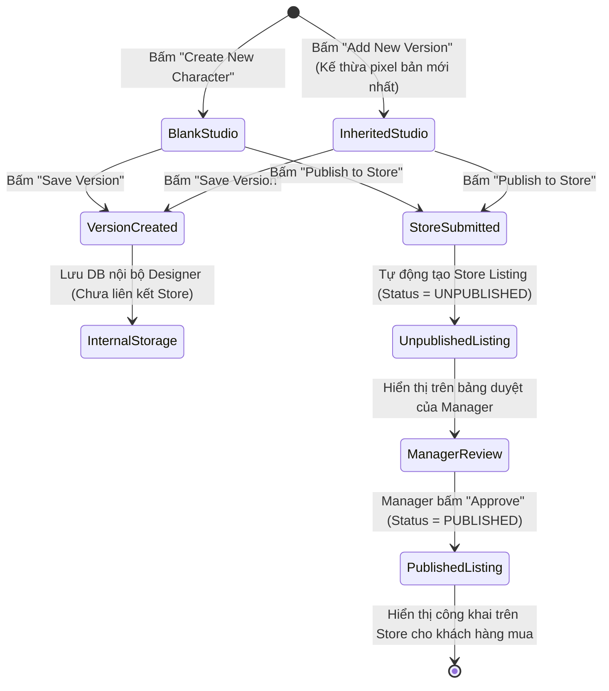

# Đặc tả Kỹ thuật & UI/UX: Luồng Tạo & Phê Duyệt Nhân Vật (Designer & Manager Character Workflow)

Tài liệu lưu trữ đặc tả yêu cầu tái cấu trúc và hoàn thiện luồng nghiệp vụ tạo nhân vật giữa **Designer** (Nhà thiết kế) và **Manager** (Quản lý cửa hàng).

---

## 1. Mô hình Dữ liệu Phân cấp (Hierarchical Data Model)

Hệ thống áp dụng mô hình phân cấp **Nhân vật & Phiên bản (Character and Version)**:
* **Ẩn dụ cốt lõi (Metaphor)**:
  * **Character (Nhân vật)** đóng vai trò như chiếc **Giỏ (Basket)**: đại diện cho hồ sơ gốc, tên gọi, phong cách nghệ thuật và ý tưởng mascot.
  * **Versions (Các phiên bản hoạt ảnh)** đóng vai trò như các **Trái cây (Fruits)** nằm bên trong giỏ: đại diện cho dữ liệu hình ảnh, ma trận pixel, số khung hình, frame delay và file binary LED.
* **Quan hệ thực thể**: Một `Character` có mối quan hệ **1 - N (1-to-Many)** với `CharacterVersion`. Một nhân vật có thể có nhiều phiên bản tiến hóa theo thời gian (`v1`, `v2`, `v3`...).

---

## 2. Chi tiết 4 Yêu cầu Nghiệp vụ & UI/UX (Core Requirements)

### 2.1. Designer Dashboard (Quản lý Danh mục Nhân vật & Phiên bản)
* **Giao diện chính**:
  * Hiển thị lưới/danh sách (Grid/List) các thực thể `Character` do chính Designer sở hữu.
  * Hiển thị thông tin tổng quan: Tên nhân vật, ảnh đại diện/animation hiện hành, tổng số phiên bản đã tạo, ngày khởi tạo.
* **Xem chi tiết phiên bản (Drill-down / Expand View)**:
  * Khi click vào một Character cụ thể, mở rộng (expand) hoặc điều hướng vào màn hình xem chi tiết hiển thị toàn bộ danh sách các thực thể `Version` thuộc nhân vật đó.
  * **Quy tắc bắt buộc**: Danh sách phiên bản **PHẢI** được sắp xếp theo trình tự thời gian từ mới nhất đến cũ nhất (`createdAt DESC` hoặc `versionNumber DESC`).
* **Hành động chính (Action Buttons)**:
  1. **"Create New Character" (Tạo nhân vật mới)**: Nút hành động toàn cục (Global action) nằm ở cấp độ danh mục, dùng để tạo một hồ sơ nhân vật hoàn toàn mới.
  2. **"Add New Version" (Thêm phiên bản mới)**: Nút hành động theo ngữ cảnh (Contextual action) chỉ xuất hiện khi Designer đang chọn/xem một Character cụ thể.

---

### 2.2. Pixel Art Studio (Kế thừa Thiết kế trên Canvas - Design Inheritance)
* **Kịch bản 1: Bấm "Create New Character"**:
  * Khởi động Pixel Art Studio (HTML5 `<canvas>`) với khung vẽ hoàn toàn trống (Blank grid, ví dụ `32x32` hoặc `64x64`).
* **Kịch bản 2: Bấm "Add New Version" cho một Character đã có**:
  * Hệ thống **BẮT BUỘC** tự động nạp (fetch) dữ liệu pixel / hình ảnh của **phiên bản mới nhất (latest existing version)** thuộc nhân vật đó.
  * Vẽ ánh xạ (map/render) lại toàn bộ ma trận điểm ảnh lên canvas của Studio.
  * **Mục đích nghiệp vụ (Design Inheritance)**: Đảm bảo Designer luôn kế thừa và phát triển tiếp từ nền tảng của phiên bản trước đó, không phải vẽ lại từ đầu khi cập nhật cử động hoặc thêm frame mới.

---

### 2.3. Thanh công cụ Studio (Save & Publish Actions)
Thay thế nút lưu chung chung (generic save) bằng **2 nút bấm chức năng độc lập**:

1. **Nút 1: "Save Version" (Lưu phiên bản)**
   * **Hành vi**: Trích xuất dữ liệu canvas (Base64 / Blob / PNG / GIF) và gửi lên backend.
   * **Kết quả**: Chỉ lưu thuần túy dưới dạng một `CharacterVersion` mới trong cơ sở dữ liệu nội bộ của Designer.
   * **Phạm vi**: Lưu trữ nội bộ, không liên kết với Cửa hàng, Manager và khách hàng không nhìn thấy.

2. **Nút 2: "Publish to Store" (Đăng bày bán)**
   * **Hành vi**: 
     1. Trích xuất và lưu `CharacterVersion` mới vào cơ sở dữ liệu.
     2. Tự động khởi tạo hoặc liên kết cập nhật một bản ghi niêm yết Cửa hàng (`Store Listing` / `Product`).
   * **Quy tắc bảo mật**: Payload gửi lên backend **BẮT BUỘC hardcode trạng thái niêm yết là `UNPUBLISHED` (Chưa công khai)**.
   * **Kết quả**: Sản phẩm ở trạng thái ẩn, chưa hiển thị cho khách hàng trên Storefront, sẵn sàng chuyển sang bước kiểm duyệt của Manager.

---

### 2.4. Phê duyệt Sản phẩm của Manager (Manager Product Listing & Approval Flow)
* **Thành phần giao diện**:
  * Bảng dữ liệu sản phẩm của Quản lý (**Manager Product Listing** data table).
  * Bộ lọc chuyên biệt: Lọc và chỉ hiển thị các Store Listing đang ở trạng thái **`UNPUBLISHED`** (Chờ duyệt).
* **Quy trình kiểm duyệt (Approval Flow)**:
  * Manager kiểm tra bản vẽ nghệ thuật, thông số khung hình, mức giá đề xuất và tag phân loại.
  * Cung cấp nút chuyển đổi trạng thái (Toggle) hoặc nút bấm **"Approve" (Duyệt mở bán)** để Manager chuyển trạng thái sản phẩm từ `UNPUBLISHED` ➡️ **`PUBLISHED` (Công khai)**.
  * Sau khi duyệt thành công, sản phẩm chính thức xuất hiện trên Cửa hàng công khai cho khách hàng mua.

---

## 3. Sơ đồ Luồng Nghiệp vụ (State Transition Diagram)

---

## 4. Tiêu chuẩn Kỹ thuật & Triển khai Giao diện (Technical Guidelines)

1. **React State & Hooks**:
   * Sử dụng đầy đủ `useState`, `useEffect`, `useCallback`, `useMemo`.
   * Quản lý trạng thái bất đồng bộ (Asynchronous loading states) mượt mà, có skeleton loader hoặc spinner chỉ báo khi:
     * Nạp dữ liệu pixel phiên bản cũ lên Canvas.
     * Trích xuất binary/blob và tải lên máy chủ.
     * Cập nhật trạng thái duyệt của Manager.
2. **Phong cách Thiết kế (Styling)**:
   * SaaS-style hiện đại, giao diện sạch sẽ, thanh lịch bằng Tailwind CSS.
   * Canvas pixel art có viền sắc nét, hiển thị rõ ràng trên nền checkerboard trong suốt.
   * Nút bấm phân tách màu sắc rõ ràng: *Save Version* (thứ cấp/ghi nhận nội bộ) vs *Publish to Store* (hành động đẩy lên hệ thống).

