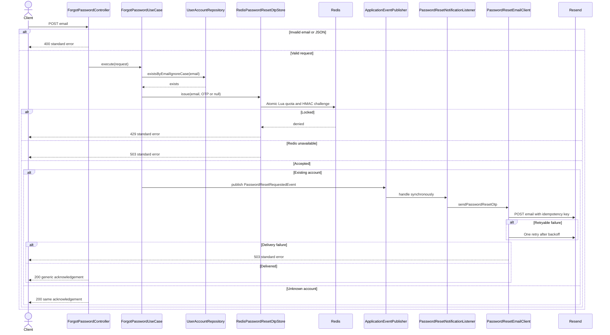
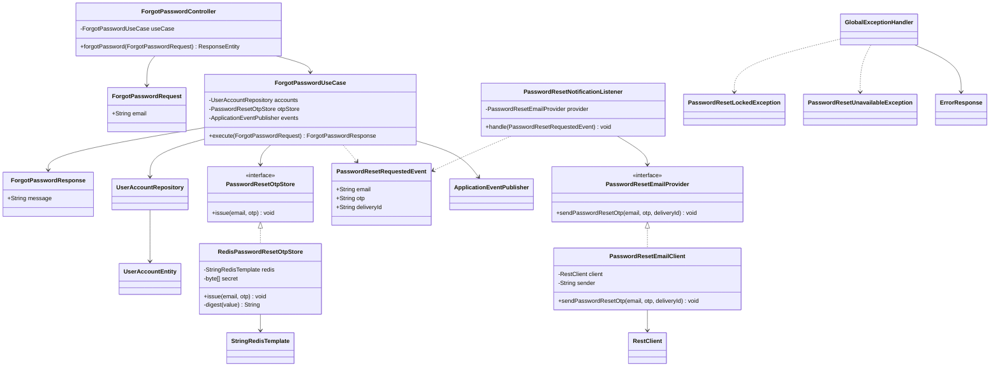

# Forgot password (IAM-07)

`POST /api/auth/forgot-password` is public and accepts `{ "email": "customer@example.com" }`.
Email is trimmed, lowercased with `Locale.ROOT`, validated and limited to 254 characters.

Success is HTTP 200 with `{ "data": { "message": "If the email is registered, a password reset code has been sent." } }`.
An unknown email receives the same acknowledgement and consumes the same request quota, without generating or sending an OTP.

For an existing email, SecureRandom generates a six-digit OTP, including leading zeros. A single Redis Lua operation checks limits and stores an HMAC-SHA256 digest for 300 seconds. Email keys are also HMAC-protected and all keys share a Redis Cluster slot. The secret is `app.jwt.secret`; changing it invalidates challenges and request counters. No database schema change is required.

The first three requests in a fixed 24-hour window are accepted. The fourth request starts a new 24-hour lock and returns HTTP 429 (`PASSWORD_RESET_LOCKED`). Rejected requests do not extend the lock. A new accepted request replaces the previous challenge. The limit applies to reset requests, not password login or OTP guesses.

After Redis accepts the request, a synchronous Spring event invokes the notification provider outside a database transaction. The reset-specific email states the five-minute expiry. HTTP connect/read timeouts are three seconds; transient network errors, 429 and 5xx receive one retry with 100ms backoff and the same delivery idempotency key. Permanent rejections are not retried.

Redis/provider failures return a safe HTTP 503 (`PASSWORD_RESET_UNAVAILABLE`) and preserve the cause internally. A delivery failure still consumes quota and leaves the short-lived challenge; the client may request another code within the remaining quota. There is no database fallback that bypasses the reset request limit. Invalid email or JSON returns 400; unexpected failures return the standard 500 envelope. Successful responses do not expose account existence, though delivery timing and provider failures are not constant-time.

This issue sends reset challenges only. OTP consumption and password changes belong to issue #8; that flow must use the dedicated HMAC password-reset keys rather than the registration OTP namespace.

## Verification

- `./mvnw.cmd test '-Dtest=*,!BackendApplicationTests'`: 203 tests passed, including 28 tests for this feature.
- `python src/test/scripts/password_reset_redis_test.py`: 9 production-Lua tests passed using `fakeredis[lua]`, including 24 concurrent requests, expiry and non-sliding lock behavior.
- The pre-existing `BackendApplicationTests` startup test is excluded because it uses environment-backed database configuration. No live database, Redis server or email provider was exercised.
- The SEP490 report is generated from the supplied `Report5_Unit Test.xls` template, with 37 feature cases across seven tested component groups. Original input remains unchanged.

Reference issue: https://github.com/LED-FOR-CAR-DECORATION/backend/issues/7

## Sequence diagram

## Class diagram

