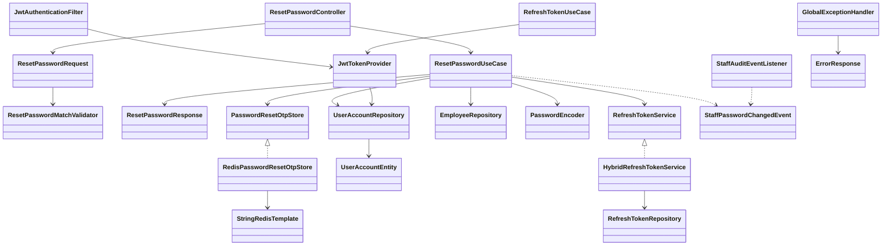

# IAM-08: Reset password

`POST /api/auth/reset-password` is public. Supply `email`, six-digit `otp`, and `newPassword`; optional `confirmPassword` must match when supplied. Email is normalized with Locale.ROOT. Passwords are 8–72 ASCII characters with uppercase, lowercase, digit and a supported special character. The standard success envelope is `data.message` with HTTP 200.

## Workflow and failures

The password-reset HMAC challenge created by issue #7 is verified and consumed atomically in Redis. Five mismatches invalidate it; missing, expired or consumed challenges return 400, and the fifth mismatch returns 429. A fresh challenge clears prior verification attempts. No registration OTP or database fallback is accepted. Redis outages fail closed with 503.

The use case hashes the password with the configured BCrypt encoder, resets failed-login counters and lockout, updates the account, and deletes database refresh records in a database transaction. OTP consumption precedes that transaction's commit: if a later database operation fails, account updates roll back but the OTP remains consumed. Request a fresh code before retrying; do not restore a consumed OTP.

Both access and refresh JWTs now carry a keyed HMAC credential version derived from the account ID and current password hash. Production token validation checks it against the current database account, so changing the password invalidates all prior tokens, including refresh tokens cached in Redis. New JWT IDs prevent identical tokens issued within one second. No password hash is exposed in JWTs, and no schema change is needed. **Legacy tokens require a fresh login after rollout.** Validation performs a database lookup and fails closed when the database is unavailable. Existing stale Redis refresh entries expire naturally and cannot authorize refresh after a password change.

Internal employee password changes publish `StaffPasswordChangedEvent`. Its listener logs account ID and role only after database commit; rolled-back changes do not generate a success audit. The repository currently uses audit logs, not a durable audit table. Customer password resets do not emit staff audit events.

## Verification

Run `./mvnw.cmd test '-Dtest=*,!BackendApplicationTests'`. The existing startup test uses environment-backed infrastructure and is excluded; all unit tests use mocks. Run `python src/test/scripts/password_reset_redis_test.py` with `fakeredis[lua]` to execute the production Lua scripts, including concurrent consumption, replay, mismatch limits, TTL and fresh-code attempt reset. No live database, Redis or email service is used.

## Sequence

```mermaid
sequenceDiagram
    actor Client
    participant API as ResetPasswordController
    participant UseCase as ResetPasswordUseCase
    participant OTP as RedisPasswordResetOtpStore
    participant Redis
    participant Accounts as UserAccountRepository
    participant Encoder as PasswordEncoder
    participant Tokens as RefreshTokenService
    participant Events as ApplicationEventPublisher
    participant Audit as StaffAuditEventListener
    Client->>API: email, otp, newPassword, optional confirmation
    API->>UseCase: execute validated request
    UseCase->>OTP: validateAndConsume
    OTP->>Redis: Atomic compare, attempt limit and delete
    alt Missing or wrong OTP
        OTP-->>Client: 400 or 429
    else Redis unavailable
        OTP-->>Client: 503
    else Valid challenge
        UseCase->>Accounts: findByEmail
        UseCase->>Encoder: BCrypt encode
        UseCase->>Accounts: save password and reset lockout
        UseCase->>Tokens: revokeAllTokensForAccount
        alt Employee
            UseCase->>Events: StaffPasswordChangedEvent
            Events->>Audit: AFTER_COMMIT log
        end
        UseCase-->>API: ResetPasswordResponse
        API-->>Client: 200 data envelope
    end
    Note over Accounts,Tokens: Database failure rolls back password changes; OTP remains consumed
    Note over Client,Accounts: Subsequent JWT validation rejects the old credential version
```

## Classes


